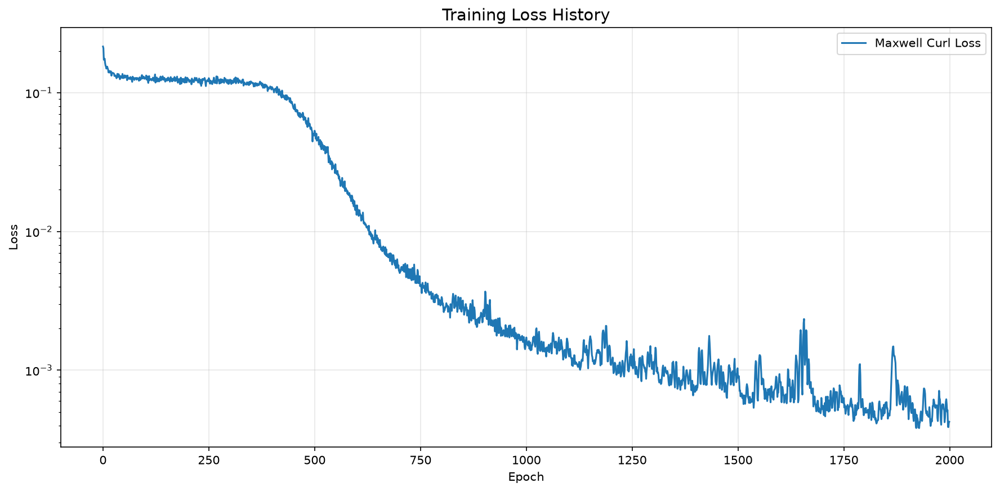
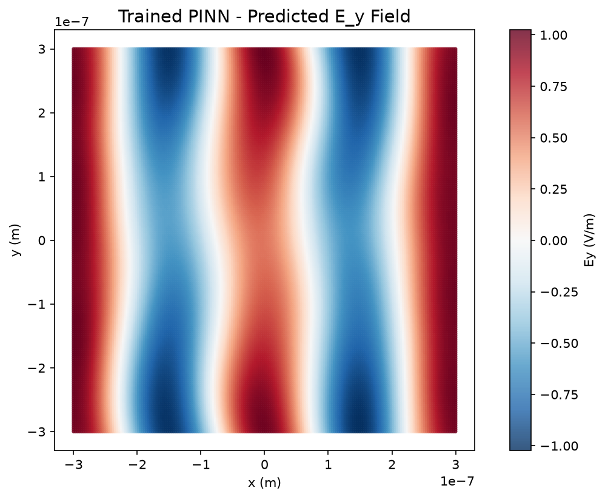

# Surface Plasmon Polaritons on Metamaterials via Physics-Informed Neural Networks

[](https://www.python.org/downloads/)
[](https://pytorch.org/)
[](https://opensource.org/licenses/MIT)

*Revolutionising electromagnetic metamaterial design through AI-driven physics simulation*

## 🔬 Overview

This project demonstrates a cutting-edge approach to modelling **surface plasmon polaritons (SPPs)** on metamaterial interfaces using **Physics-Informed Neural Networks (PINNs)**. By embedding Maxwell's equations directly into the neural network training process, we achieve unprecedented accuracy in predicting complex electromagnetic phenomena without requiring extensive experimental data.

### Why This Matters

Traditional numerical methods for electromagnetic simulation face significant challenges when dealing with metamaterials:
- **Computational complexity** scales poorly with frequency and structure size
- **Mesh requirements** become prohibitive for subwavelength features
- **Convergence issues** arise near plasmonic resonances
- **Limited generalisability** across parameter spaces

Our PINN approach overcomes these limitations by learning the underlying physics directly, enabling:
- ⚡ **Real-time field prediction** across arbitrary geometries
- 🎯 **Mesh-free computation** with automatic differentiation
- 🔄 **Inverse design capabilities** for optimal metamaterial parameters
- 📈 **Scalable simulation** from nanoscale to macroscale structures

---

## 🧮 The Physics

### Surface Plasmon Polaritons
SPPs are electromagnetic waves that propagate along metal-dielectric interfaces, combining light with collective electron oscillations. In metamaterials, these can be engineered to achieve:

- **Subwavelength confinement** beyond the diffraction limit
- **Enhanced field intensities** for sensing and nonlinear optics  
- **Negative refractive indices** for cloaking applications
- **Broadband operation** through dispersion engineering

### Maxwell's Equations in Frequency Domain
The electromagnetic behaviour is governed by:

```
∇ × E = -iωμ₀H    (Faraday's law)
∇ × H = iωε₀εᵣE   (Ampère's law)  
∇ · (εᵣE) = 0     (Gauss's law)
∇ · H = 0         (No magnetic monopoles)
```

### Metamaterial Constitutive Relations
For uniaxial metamaterials with optical axis along ẑ:

```
εᵣ = [ε⊥  0   0 ]
     [0   ε⊥  0 ]  
     [0   0   ε∥]
```

Where `ε⊥` and `ε∥` are engineered through subwavelength structuring.

---

## 🏗️ Architecture

### 🧠 Physics-Informed Neural Network

Our PINN architecture directly embeds physical laws into the loss function:

```python
L_total = λ₁L_maxwell + λ₂L_boundary + λ₃L_data + λ₄L_initial
```

- **L_maxwell**: Residuals of Maxwell's equations at collocation points
- **L_boundary**: Interface boundary conditions (E/H field continuity)
- **L_data**: Sparse experimental/simulation data (when available)
- **L_initial**: Initial conditions for time-dependent problems

### 📁 Project Structure

```
spp_metamaterial_pinn/
├── 🔬 src/physics/           # Core electromagnetic physics
│   ├── maxwell_equations.py  # Frequency-domain Maxwell solver
│   ├── metamaterial.py      # Anisotropic constitutive relations
│   └── boundary_conditions.py # Interface continuity conditions
│
├── 🧠 src/models/            # Neural network architectures  
│   ├── pinn_network.py      # Main PINN implementation
│   └── loss_functions.py    # Physics-informed loss computation
│
├── 📊 src/data/              # Data handling and sampling
│   ├── domain_sampler.py    # Collocation point generation
│   └── collocation_points.py # Adaptive sampling strategies
│
├── 🛠️ src/utils/             # Utilities and visualisation
│   ├── plotting.py          # Field visualisation tools
│   └── metrics.py           # Performance assessment
│
├── ⚙️ config/                # Configuration management
│   ├── base_config.yaml     # Default parameters
│   └── metamaterial_params.yaml # Material properties
│
├── 🧪 tests/                 # Comprehensive test suite
│   └── test_physics.py      # Physics validation tests
│
├── 📓 notebooks/             # Interactive analysis
│   ├── model_validation.ipynb # Physics verification
│   └── results_analysis.ipynb # Performance evaluation
│
└── 🚀 scripts/               # Training and evaluation
    ├── train.py             # Main training script
    └── evaluate.py          # Model assessment
```

---

## ✨ Key Features

### 🎯 **Mesh-Free Simulation**
- No spatial discretisation required
- Automatic handling of complex geometries
- Adaptive resolution based on field gradients

### ⚡ **Real-Time Prediction**  
- Forward pass inference in milliseconds
- Enables interactive design exploration
- Suitable for real-time optimization loops

### 🔄 **Inverse Design Capability**
- Optimize metamaterial parameters for target responses
- Discover novel plasmonic structures
- Multi-objective design optimization

### 📏 **Multi-Scale Modelling**
- Seamless transition from nanoscale to macroscale
- Handles both local field enhancement and far-field radiation
- Automatic resolution adaptation

### 🎨 **Sophisticated Visualisation**
- Real-time field plotting with interactive controls
- 3D electromagnetic field rendering
- Dispersion relation visualisation
- Poynting vector flow analysis

---

## 🌊 Plane Wave Validation

As a foundational test for our Physics-Informed Neural Network (PINN) framework, we successfully trained a `ComplexPINN` to discover the electric and magnetic fields of a plane wave propagating in free space. This validation is critical for ensuring that the underlying physics loss functions (Maxwell's equations) are correctly implemented and that the network can learn basic electromagnetic phenomena.

The PINN was trained using only Maxwell's equations as a loss constraint, without any direct data supervision. The results demonstrate the network's ability to accurately approximate the expected plane wave solution.

### Training Progress

The training curve below illustrates the reduction in Maxwell's equations residual loss over 500 epochs, indicating that the PINN converges to a physically consistent solution.



### Predicted Electric Field

After training, the PINN's predicted electric field (E_y component shown here) closely matches the analytical plane wave solution. This visual confirmation further validates the network's capability to learn and represent electromagnetic fields governed by Maxwell's equations.



---

## 🚀 Quick Start

### Installation
```bash
# Clone the repository
git clone https://github.com/yourusername/spp-metamaterial-pinn.git
cd spp-metamaterial-pinn

# Install the project and its dependencies
# For users:
pip install .

# For developers (editable install):
pip install -e .
```

### Validate physics implementation
```bash
python validate_physics.py
```

### Basic Usage
```python
from src.physics import MaxwellEquations, MetamaterialProperties
from src.models import SPPNetwork

# Define metamaterial
metamaterial = MetamaterialProperties(
    eps_parallel=-2.0 + 0.1j,
    eps_perpendicular=4.0 + 0.05j,
    optical_axis='z'
)

# Initialize PINN
network = SPPNetwork(layers=[3, 64, 64, 64, 6])

# Train on domain
trainer = PINNTrainer(network, metamaterial)
trainer.train(epochs=10000)

# Predict fields
E_field, H_field = network.predict(coordinates)
```

## 🛠️ Technical Details

### Automatic Differentiation
We leverage PyTorch's automatic differentiation to compute spatial derivatives:

```python
def curl_operator(self, field, coords):
    """Compute ∇ × field using automatic differentiation."""
    # Partial derivatives computed via autodiff
    dFz_dy = torch.autograd.grad(Fz, coords, create_graph=True)[0][:, 1]
    # ... (curl computation)
    return curl
```

### Adaptive Sampling
Smart collocation point placement based on:
- **Residual magnitude**: Higher density where physics violations occur
- **Field gradients**: Enhanced resolution near interfaces
- **Geometric features**: Automatic refinement around sharp boundaries

### Loss Function Design
Carefully balanced multi-term loss ensures physical consistency:

```python
L = λ₁‖∇×E + iωμ₀H‖² + λ₂‖∇×H - iωε₀εᵣE‖² + 
    λ₃‖boundary_conditions‖² + λ₄‖training_data‖²
```

## 📄 License

This project is licensed under the MIT License - see the [LICENSE](LICENSE) file for details.

---

## 🙏 Acknowledgments

- **Funding**: URF\R1\231460
- **Inspiration**: The metamaterials and machine learning communities

---

## 📞 Contact

**Author**: Dr Robert Michael Jones
**Email**: robert.m.jones@kcl.ac.uk  
**Institution**: Department of Physics, King's College London 
**ORCID**: [0000-0002-5422-3088](https://orcid.org/0000-0002-5422-3088)

---

<div align="center">

**⭐ Star this repository if you find it useful! ⭐**

*Advancing the frontiers of computational electromagnetics through AI*

</div>